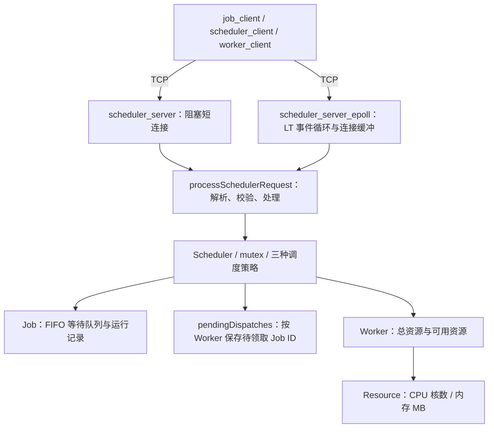

# HeteroSched

C++17 轻量 TCP 资源调度器原型：集中管理 Worker 的 CPU/内存，完成 Job 入队、资源预留、领取与完成回收。
面向 Linux / WSL2；Worker 以休眠 500 ms 模拟执行，用于学习和演示系统编程，不是生产级异构计算平台。

## 核心功能

- FIFO 等待队列，FirstFit、BinPack、LeastAllocated 三种资源放置策略。
- Scheduler 以 mutex 保护队列、运行记录、派发记录和资源；拒绝重复 ID、重复领取与重复完成。
- TCP 换行分帧，正文上限 128 字节，协议字段校验，处理部分收发与 EINTR。
- 阻塞版逐连接处理，每连接一条请求；epoll 版单线程 LT，支持同连接多请求、缓冲、背压和连接清理。
- epoll 可选空闲超时和连接上限，默认关闭；两版默认 backlog=128，支持 `--quiet`。

## 架构



两种入口各自创建独立 Scheduler，不共享内存状态；Worker 客户端通过短连接轮询。
[可编辑 draw.io 架构图](assets/architecture.drawio) · [图像预览](assets/architecture.png)

## 构建与运行

依赖：Linux、C++17 编译器、CMake ≥3.16、pthread；完整测试和网络压测另需 Python 3（标准库）。

```bash
cmake -S . -B build -DCMAKE_BUILD_TYPE=Release
cmake --build build --parallel
ctest --test-dir build --output-on-failure
./build/heterosched
./build/scheduler_benchmark
```

2026-10-17 复核：Release 构建成功，**11/11 个 CTest 目标通过**。测试名为：
`scheduler_tests`、`job_dispatch_tests`、`tcp_io_tests`、`epoll_server_io_tests`、
`tcp_benchmark_tests`、`epoll_server_integration_tests`、`tcp_comparison_tests`、
`registration_tests`、`job_submission_tests`、`job_completion_tests`、`scheduler_protocol_tests`。
覆盖调度与资源边界、并发领取/完成去重、分帧、非法输入、断开、部分写、背压及 epoll 超时/连接限制。

网络演示按顺序在三个终端运行（客户端固定连接 `127.0.0.1:9000`）：

```bash
# 终端 1：启动其中一个服务端
./build/scheduler_server_epoll --port 9000
# 或 ./build/scheduler_server --port 9000
# 终端 2：注册并持续领取、模拟执行、上报完成
./build/worker_client 1 4 8192
# 终端 3：提交任务
./build/job_client 101 2 1024
```

Worker 日志应出现 `started Job 101`、`finished Job 101`；使用 Ctrl+C 结束进程。
手动接口：`./build/scheduler_client next` 和 `./build/scheduler_client complete 101`；已完成的任务再次完成会被拒绝。

## 性能测试

对比脚本自动启动空 Scheduler、等待就绪、关闭逐请求日志，交替运行两版；无需手动启动服务端。
每轮新建进程，串行预热 10 次，正式 1000 次请求，每连接一条 `SCHEDULE_NEXT`，不重试失败请求。

```bash
python3 benchmarks/compare_tcp_servers.py --build-dir build \
  --requests 1000 --warmup 10 --concurrency 1 10 50 100 --repeat 3 \
  --timeout 1 --backlog 128 --output-dir build/tcp-comparison
# 旧条件复现：上述命令改为 --backlog 1，并使用不同的 --output-dir
```

环境：AMD Ryzen 7 6800H，WSL2 Linux 6.6.87.2，16 逻辑 CPU，GCC 13.3.0，Python 3.12.3，Release `-O3 -DNDEBUG`。
下表为三轮各指标的中位数，单元格为 **阻塞 / epoll**；两版各完成 12,000/12,000 次请求，峰值 RSS 中位数均 3200 KiB。

| 并发客户端 | 吞吐 req/s | P50 ms | P95 ms | 服务端 CPU %（单核） | 失败率 % |
|---:|---:|---:|---:|---:|---:|
| 1 | 4936 / 4635 | 0.158 / 0.160 | 0.235 / 0.239 | 39.4 / 48.9 | 0 / 0 |
| 10 | 2127 / 2117 | 4.277 / 4.277 | 6.159 / 6.192 | 12.8 / 19.1 | 0 / 0 |
| 50 | 2146 / 2090 | 21.335 / 21.385 | 29.884 / 32.626 | 12.9 / 19.0 | 0 / 0 |
| 100 | 1980 / 2054 | 44.636 / 40.981 | 66.866 / 69.543 | 14.5 / 18.6 | 0 / 0 |

延迟从 connect 前计时至完整响应到达，仅统计成功请求；吞吐为成功数/整轮耗时，失败请求仍占总数和耗时。
`--timeout` 是每次 socket 操作超时，不是请求总截止时间。JSON 保留所有耗时、失败阶段、环境及二进制/源码哈希。

原超时已复现：backlog=1 时阻塞版失败 2047/12000、epoll 失败 4/12000，全部在 connect 阶段；
并发 10 的阻塞版三轮失败 18/13/14 次，同时观察到监听队列溢出计数增加。相同基线二进制仅改 backlog=128 后，两版均零失败。
这是连接排队容量问题；增大 backlog 不会让阻塞版同时服务多个连接，也不能隔离慢客户端。
短请求下两版吞吐接近，Python 线程客户端与本机调度也影响结果；不能据此声称 epoll 普遍加速或代表调度核心性能。

受控慢客户端对比（移除慢连接后检查服务恢复；阻塞版失败会使脚本返回 1）：

```bash
python3 benchmarks/compare_tcp_servers.py --build-dir build --requests 100 --warmup 10 \
  --concurrency 10 50 100 --repeat 3 --timeout 0.2 --backlog 128 --slow-clients 1 \
  --output-dir build/tcp-one-slow
```

慢客户端实验中阻塞版 900/900 次正常请求接收超时，epoll 900/900 成功；无慢连接对照两版均 900/900 成功，释放慢连接后恢复探测全部通过。

[本次原始结果](benchmarks/results/final_review/)包括旧条件、backlog 单变量对照、最终短请求和慢客户端实验；历史数据保持不变。
`tcp_benchmark.py` 用于已有空服务端；`scheduler_benchmark` 独立比较固定种子负载的调度策略。

## 已知限制与后续

- 严格 FIFO 存在队头阻塞；网络入口使用默认 FirstFit，三种策略对比在核心 benchmark 中。
- 调度成功即预留资源，领取只消费派发记录，完成才释放；响应丢失或 Worker 崩溃不自动回滚，不能保证端到端 exactly-once。
- 状态仅驻内存、队列无总量上限；仅监听 loopback，无认证/TLS、持久化、心跳恢复、GPU/NPU 调度或真实 AI 任务执行。
- epoll 仍同步执行协议与调度逻辑，不是多线程并行；阻塞版接收超时为每次 recv 5 秒，持续补字节可延长占用。
- 本版不实现优雅停机；心跳恢复和真实工作负载仅为按需后续方向，不作为展示前置条件。
