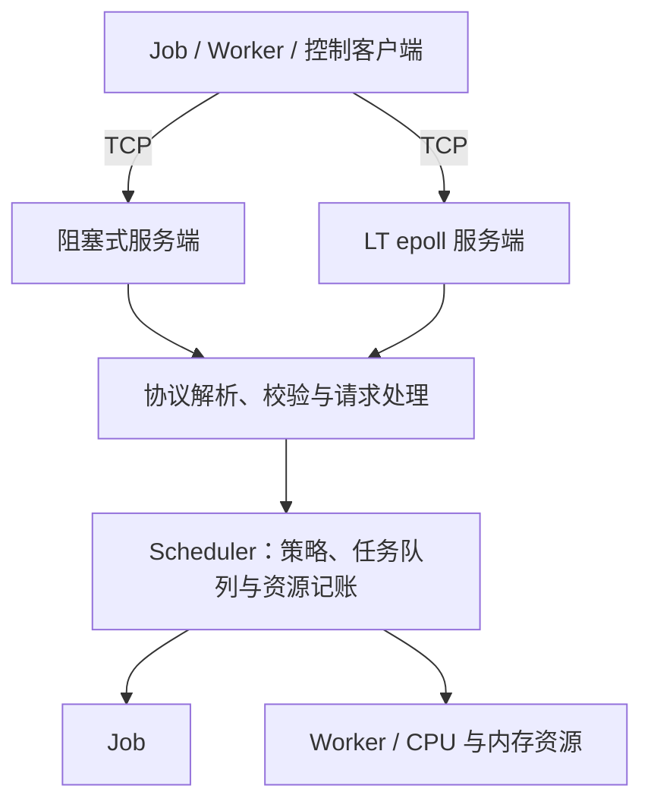

# HeteroSched

使用 C++17 实现的轻量 TCP 资源调度器原型，集中管理 Worker 的 CPU/内存，完成任务提交、排队、资源预留、领取和完成回收。
面向 Linux / WSL2 系统编程学习与演示；Worker 使用 500 ms 休眠模拟执行。

## 核心功能

- FIFO 等待队列，FirstFit、BinPack、LeastAllocated 三种资源放置策略。
- mutex 保护调度状态与资源记账，防止重复领取和重复完成；校验输入并拒绝重复 ID。
- 换行分帧的 TCP 文本协议，处理部分收发、消息长度限制和连接异常。
- 阻塞版逐连接处理，每连接一条请求；单线程 LT epoll 版支持多连接、持续请求、连接缓冲和输出背压。
- 两版默认 backlog=128；epoll 可选连接空闲超时和连接上限，默认关闭。

## 架构与目录



两种服务端各自拥有独立的 Scheduler；Worker 客户端使用短连接轮询。
[可编辑 draw.io 图（4 页）](assets/architecture.drawio) · [架构总览](assets/architecture.png)

[Worker 任务时序](assets/architecture-lifecycle.png) · [LT epoll 连接处理](assets/architecture-epoll.png) · [CMake 模块依赖](assets/architecture-modules.png)

`apps/` 放置 6 个应用入口；`include/` 与 `src/` 按 `core/`、`net/`、`protocol/` 对应划分接口与实现。
`tests/` 按同样的模块边界组织测试；`benchmarks/` 保存调度 benchmark、TCP 压测工具与原始结果。
CMake 构建 3 个模块库、6 个应用和 1 个 `scheduler_benchmark`，另有测试可执行目标。

## 构建与运行

依赖 Linux、C++17 编译器、CMake ≥3.16 和 pthread；完整测试与 TCP 压测另需 Python 3 标准库。

```bash
cmake -S . -B build -DCMAKE_BUILD_TYPE=Release
cmake --build build --parallel
ctest --test-dir build --output-on-failure
./build/heterosched
```

网络演示按顺序在三个终端运行，客户端固定连接 `127.0.0.1:9000`：

```bash
# 终端 1：选择一种服务端
./build/scheduler_server_epoll --port 9000
# 或 ./build/scheduler_server --port 9000
# 终端 2：注册 Worker，持续领取并模拟执行任务
./build/worker_client 1 4 8192
# 终端 3：提交任务
./build/job_client 101 2 1024
```

Worker 日志应出现 `started Job 101` 和 `finished Job 101`；使用 Ctrl+C 结束进程。
另有 `scheduler_client` 提供手动调度与完成接口，`scheduler_benchmark` 比较固定种子负载下的三种策略。

## 测试与验证

2026-10-17 复核：Release 构建成功，**11/11 项 CTest 通过**。测试目标如下：

| 模块 | CTest 名称 |
|---|---|
| core | `scheduler_tests`、`job_dispatch_tests` |
| net | `tcp_io_tests`、`epoll_server_io_tests`、`tcp_benchmark_tests`、`epoll_server_integration_tests`、`tcp_comparison_tests` |
| protocol | `registration_tests`、`job_submission_tests`、`job_completion_tests`、`scheduler_protocol_tests` |

覆盖资源边界与回收、并发领取/完成去重、分帧、非法输入、连接断开、部分写、背压及 epoll 连接限制。
[已归档压测与验证记录](benchmarks/results/final_review/validation.json)包含命令、环境、原始样本入口及 backlog/慢客户端对照；短请求结果不代表真实任务执行性能。
TCP 对比工具为 `benchmarks/compare_tcp_servers.py`，参数可通过 `python3 benchmarks/compare_tcp_servers.py --help` 查看。

## 重要限制

- 严格 FIFO 存在队头阻塞；网络入口使用默认 FirstFit，三种策略对比在核心 benchmark 中。
- 调度时预留资源，领取不重复扣减，完成后释放；响应丢失或 Worker 崩溃不自动回滚，不能保证端到端 exactly-once。
- 状态仅驻内存，队列无总量上限；仅监听 loopback，无认证/TLS、持久化、心跳恢复、GPU/NPU 调度或真实 AI 任务执行。
- epoll 同步执行协议与调度逻辑，不是多线程并行；阻塞版会受慢连接影响，增大 backlog 无法隔离慢客户端。
- 本版不支持优雅停机；后续功能按实际需要决定。
